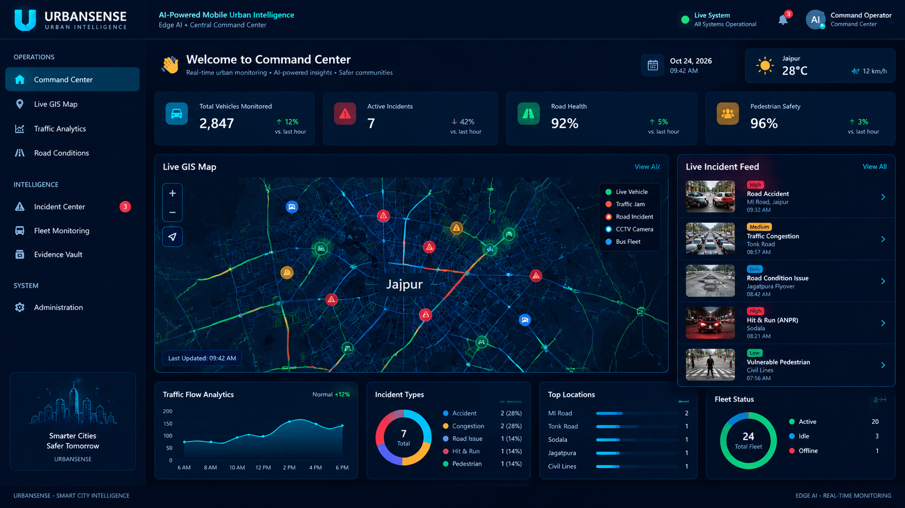

-blue)


# 🚌 AI-Powered Mobile Urban Intelligence Platform

> Turning public transport buses into mobile urban sensing units with edge AI and a centralized urban-intelligence command center.

**Problem Statement ID:** 26124  
**Domain:** Smart Cities · Urban Mobility · Computer Vision  
**SIH 2026 Internal Hackathon:** Ranked 13th out of 150 teams (Top 9%)

---

## 🖥️ Dashboard Design Preview



> **Design note:** This image is a UI design mockup showing the intended command-center look and layout. It is not a screenshot of the currently running application, and the displayed map markers, charts, and values are illustrative rather than verified live data.

---

## 📖 Overview

Public transport buses travel across large portions of a city every day and may carry multiple cameras. URBANSENSE explores how these vehicles can act as mobile sensing platforms, detecting urban road and traffic issues at the edge and sending compact event metadata to a central command center.

The platform is designed to identify:

- 🕳️ **Road defects:** potholes, cracks, and damaged road surfaces.
- 🚧 **Missing infrastructure:** traffic signs, dividers, and zebra crossings.
- 🚶 **Pedestrian risks:** vulnerable pedestrians and potentially unsafe crossings.
- 🚗 **Traffic incidents:** hit-and-run and rash-driving events, with an ANPR workflow.
- 🚦 **Congestion:** vehicle density and traffic bottlenecks.

The edge-processing approach sends event metadata instead of continuously uploading raw video. The project describes a low-bandwidth event payload of approximately **2 KB per event**, compared with a much larger video clip; bandwidth savings depend on the video duration, encoding, and deployment configuration.

---

## ✨ Key Features

### Onboard Edge AI

- Multi-model inference using YOLOv8 and a custom pothole detector.
- Project-reported custom-model metrics: **mAP@0.5 0.75**, **precision 0.82**, and **recall 0.67**.
- Transfer learning on an annotated Indian-road dataset.
- Multi-class detection for road defects, pedestrians, vehicles, and missing infrastructure.
- ByteTrack-based tracking to help reduce duplicate detections across frames.
- SQLite event buffering when network connectivity is unavailable.
- Compact JSON event payloads for lower-bandwidth reporting.

### Central Command Center

- FastAPI REST API with OpenAPI/Swagger documentation.
- WebSocket event streaming for live updates.
- React + Vite dashboard with Leaflet maps and Recharts visualizations.
- ANPR workflow for hit-and-run incident review.
- Fleet/event simulator for demonstrations and load testing.

### Dashboard Modules

| Module | Purpose |
| --- | --- |
| Command Center | KPI cards and recent event feed |
| Live GIS Map | Geographic view of buses and event markers |
| Traffic Analytics | Traffic and speed trend visualizations |
| Road Conditions | Road-hazard distribution and defect overview |
| Incidents | Incident review and ANPR-related workflow |
| Fleet Monitoring | Bus/fleet status overview |
| Evidence Vault | Evidence and frame-snapshot review |
| Admin | Simulator controls and system diagnostics |

---

## 🏗️ Architecture

```text
┌──────────────────────────────────────────────────────────────┐
│                    EDGE AI · ONBOARD BUS                     │
│                                                              │
│  Camera/video feed ──▶ YOLOv8 detector ──▶ Event generator    │
│                                      GPS + timestamp          │
│                                               │              │
│                                               ▼              │
│                                  ┌────────────────────────┐  │
│                                  │ SQLite offline buffer  │  │
│                                  └────────────┬───────────┘  │
└───────────────────────────────────────────────┼──────────────┘
                                                │
                                   Compact event metadata
                                                │
                                                ▼
┌──────────────────────────────────────────────────────────────┐
│                 CENTRAL COMMAND CENTER                       │
│                                                              │
│  FastAPI ingestion ──▶ Database ──▶ React dashboard           │
│         │                         ├─ Leaflet GIS              │
│         └── WebSocket events      └─ Recharts analytics       │
└──────────────────────────────────────────────────────────────┘
```

## 🛠️ Tech Stack

| Layer | Technology |
| --- | --- |
| Edge AI | Python, Ultralytics YOLOv8, OpenCV, ByteTrack, SQLite |
| Backend | FastAPI, SQLAlchemy, Pydantic, Uvicorn, WebSocket |
| Frontend | React, Vite, Leaflet, React Leaflet, Recharts, Tailwind CSS |
| Database | SQLite (with a path toward spatial-database integration) |
| Deployment | Docker, Docker Compose |

---

## 📂 Project Structure

```text
mobile-urban-intelligence/
├── edge/                       # Onboard AI pipeline
│   ├── detector.py              # YOLOv8 inference
│   ├── tracker.py               # ByteTrack tracking
│   ├── gps_simulator.py         # GPS route simulation
│   ├── event_engine.py          # Event schema and severity
│   ├── uploader.py              # HTTP uploader and offline buffer
│   ├── pipeline.py              # Frame orchestration
│   ├── run.py                   # CLI entry point
│   ├── config.py                # Thresholds and paths
│   ├── models/                  # Model weights, if supplied
│   └── data/                    # Local video inputs (gitignored)
├── backend/                     # Central API
│   ├── app/
│   │   ├── main.py              # FastAPI application
│   │   ├── api/                 # API routes
│   │   ├── db/                  # Database models
│   │   ├── services/             # Business logic
│   │   ├── ai/                  # AI integration hooks
│   │   └── sim/                 # Fleet simulator
│   └── evidence/                # Evidence snapshots
├── frontend/                    # React dashboard
│   ├── src/
│   │   ├── pages/               # Dashboard pages
│   │   ├── components/          # Reusable UI components
│   │   ├── layout/              # Navigation/layout
│   │   └── services/             # API and WebSocket clients
│   └── package.json
├── urbansense-dashboard-mockup.png
├── docker-compose.yml
└── README.md
```

---

## 🚀 Quick Start

### Prerequisites

- Python 3.11 or newer (Python 3.12 is also suitable for supported dependencies).
- Node.js 18 or newer.
- Git.
- Optional: CUDA-compatible GPU for faster inference.

### 1. Clone the repository

```bash
git clone https://github.com/Vikashprajapat959/mobile-urban-intelligence.git
cd mobile-urban-intelligence
```

### 2. Install backend dependencies

Run these commands from the repository root in PowerShell on Windows:

```powershell
cd backend
python -m venv .venv
.\.venv\Scripts\Activate.ps1
pip install -r requirements.txt
```

If PowerShell blocks virtual-environment activation, use your system's approved activation method or run the environment's Python executable directly.

### 3. Install edge dependencies (optional for dashboard-only use)

Open another terminal at the repository root:

```powershell
cd edge
pip install -r requirements.txt
```

### 4. Install frontend dependencies

Open another terminal at the repository root:

```powershell
cd frontend
npm install
```

### 5. Start the backend API

Open a terminal at the repository root and run:

```powershell
cd backend
.\.venv\Scripts\Activate.ps1
uvicorn app.main:app --reload --host 127.0.0.1 --port 8000
```

API documentation: <http://127.0.0.1:8000/docs>

### 6. Start the frontend dashboard

In a **separate terminal**, run:

```powershell
cd frontend
npm run dev
```

Then open <http://localhost:5173> in your browser. The backend should be running for API-backed data to load.

### 7. Run edge inference (optional)

From the repository root, with the backend already running and a compatible local video/model available:

```powershell
cd edge
python run.py --video "data/bus_01.mp4" --bus-code BUS-101 --api-url http://127.0.0.1:8000
```

The edge runner requires its input video and model files to exist locally; these files may not be included in the repository.

### 8. Simulate multiple buses (optional)

The following commands are examples for separate terminals, provided the input videos and dependencies are available:

```powershell
python run.py --video "data/bus_01.mp4" --bus-code BUS-101
python run.py --video "data/bus_02.mp4" --bus-code BUS-102
python run.py --video "data/bus_03.mp4" --bus-code BUS-103
python run.py --video "data/bus_04.mp4" --bus-code BUS-104
```

---

## 📊 Model Performance

The following metrics are reported for the custom pothole model/project setup. Reproduce them on the same dataset and evaluation configuration before comparing them with other models.

| Metric | Reported value |
| --- | ---: |
| mAP@0.5 | 0.75 |
| mAP@0.5:0.95 | 0.426 |
| Precision | 0.82 |
| Recall | 0.67 |
| Inference speed | ~38 ms/frame (CPU) |
| Training configuration | YOLOv8n, 100 epochs, transfer learning |
| Dataset | Custom annotated Indian-road dataset + RDD2022 |

---

## 🎯 Project Highlights

- Ranked **13th out of 150 teams** at the SIH 2026 internal hackathon (as reported by the team).
- Edge-first event reporting designed to reduce the need to transfer raw video.
- SQLite-backed buffering for intermittent connectivity.
- Multi-bus event simulation and a centralized dashboard workflow.
- ANPR incident-demo workflow; the project reports 94% OCR confidence for its demo setup.
- OpenAPI documentation available at `/docs` when the backend is running.

> Reported performance figures are dependent on the project configuration and demo setup. Distinguish simulated/demo results from measurements collected in a deployed environment.

---

## 🔮 Future Work

- Expand and validate training data, including additional RDD2022 samples.
- Evaluate the pothole detector with a reproducible validation protocol.
- Replace mock ANPR components with a production OCR pipeline such as PaddleOCR.
- Improve vehicle counting and congestion heatmaps.
- Test deployment on edge hardware such as NVIDIA Jetson Orin Nano.
- Evaluate spatial database options such as PostGIS for production GIS queries.
- Strengthen role-based access control and deployment security.

---

## 👤 Author

**Vikash Prajapat**  
GitHub: [@Vikashprajapat959](https://github.com/Vikashprajapat959)

Built collaboratively for the SIH 2026 internal hackathon — **AI-Powered Mobile Urban Intelligence Platform**.

## 📄 License

This project is licensed under the MIT License. See [`LICENSE`](LICENSE) for details.
